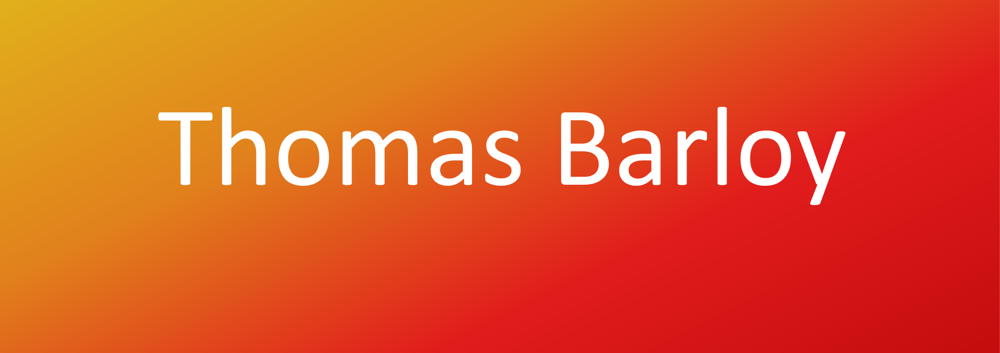

## ❓ Qui suis-je ?
 
Bonjour ! Je suis un étudiant en 2e année de BUT Informatique à L'IUT de Lens passionné par le développement d'applications, le développement web et la gestion de base de données !

  

## 🛠️ Mes maîtrises
 

### Langages

 

### Base de données & web

 

### Outils

  

## 📫 Me contacter

  
  

